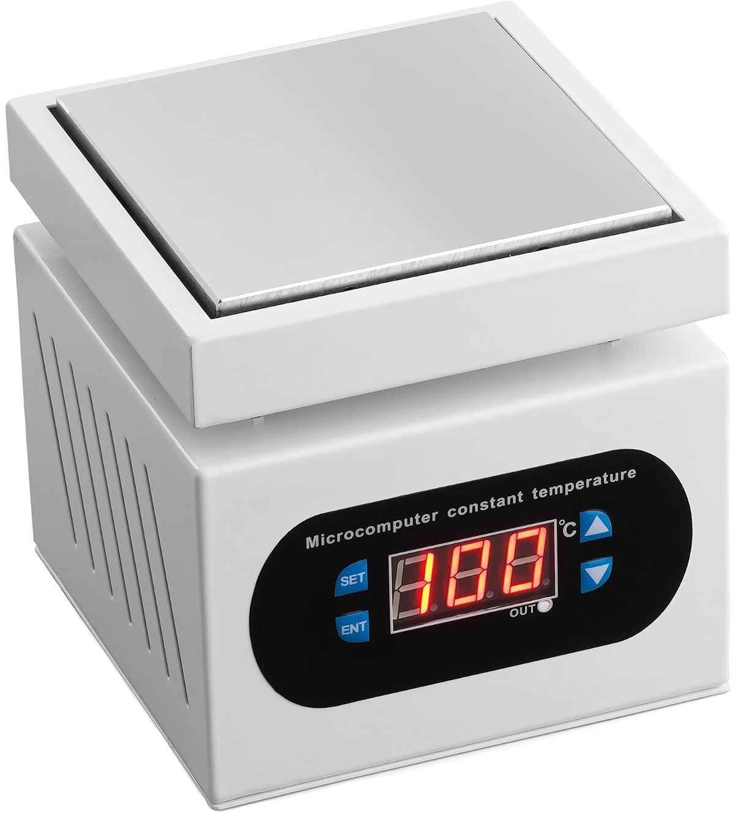
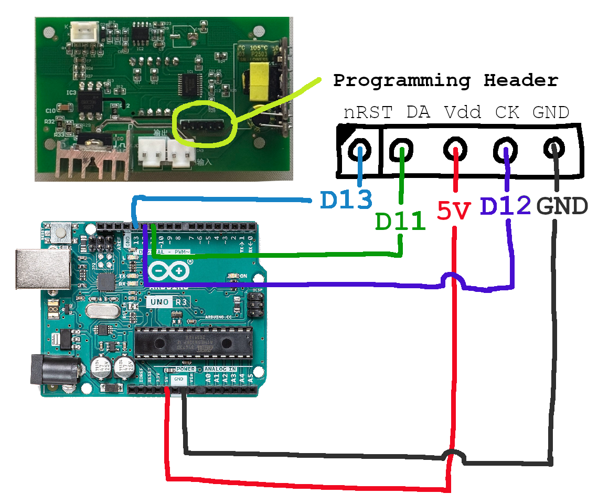

# MCCT Reflow

An open alternative firmware for generic "MicroComputer Constant Temperature"-style hot plates that adds solder reflowing curves for common paste types.

## Supported Hardware

- Tested on the 350W (110V, 400C) 100mm x 100mm model. (PCB: `SW-1010 V1.96`)
- Do not use this device on circuits that are not 110V 60Hz.



## Features

| Capability | Factory Firmware | MCCT-Reflow Firmware |
|---|:---:|:---:|
| Automatic and manual PID tuning | ✅ | ✅ |
| Manual temperature offset | ✅ | ✅ |
| Overtemperature shutdown | ✅ | ✅ |
| Last config saved to flash | ✅ | ✅ |
| Easy to use menu | ❌ | ✅ |
| Customizable reflow curves for Sn63Pb37, SAC305, and Sn42Bi58 pastes | ❌ | ✅ |
| Automatic timer shutdown | ❌ | ✅ |
| Optional calibration routine with external probe | ❌ | ✅ |
| Highly configurable | ❌ | ✅ |
| Adjustable display brightness *(planned)* | ❌ | 🚧 |
| Full control over USB *(planned)* | ❌ | 🚧 |

## Flashing Setup

### Wiring

***IMPORTANT: UNPLUG THE HOTPLATE FIRST*** \
Wire your programmer to the chip. The MS51FB9AE firmware must be flashed over ICP, and I use an Arduino Uno R3 as a bridge.


### Flash Binary

Download the ICP bridge:
```
git submodule update --init tools/NuMicro-8051-prog
```
Install [uv](https://docs.astral.sh/uv/) \
Install or unzip arduino-cli to `tools\arduino-cli\` (or on PATH) \
Run
```
arduino-cli core update-index
arduino-cli core install arduino:avr
```
Load the patched bridge onto the Uno
```
uv run mcct.py bridge
```
Download the `.bin` from the latest release and flash it with `uv run mcct.py flash --bin mcct.bin`. If the script can't find your board, add it with `--port`.

---

The first flash may require power cycling the chip (unplug and replug 5V and GND) to get it to reset, as the reset pin could be disabled by factory firmware. \
***DISCONNECT THE PROGRAMMING WIRES BEFORE PLUGGING THE PLATE BACK IN***

## Configuration & Calibration

- Requires [rebuilding the firmware](CONTRIBUTING.md#building-firmware) (Windows only)
- Firmware options: see `mcct-firmware/config/user_config.h`.
- Calibration: see `mcct-firmware/calibration/adc_to_temperature.csv`. A curve is fitted during build and written to the chip.
- To alter the reflow profiles, edit `mcct-firmware/profiles/*.json`. The profiles will be validated during the build and written to the chip. For each waypoint, the setpoint ramps linearly to `temp_c` over `ramp_s`, the controller waits for the plate to get there, then holds `hold_s`.
- Exact calibration procedure: TODO. For now just ask your agent.

## Basic Usage

- ***DISCONNECT THE PROGRAMMING WIRES BEFORE PLUGGING THE PLATE BACK IN***
- In standby: Up/Down keys to change target temperature, ENT to confirm or stop heating
- SET to enter settings menu. Options: reflow, tune, PID, offset, or reset. ENT to select, SET to exit.
    - Reflow (rFL): select a profile
    - Tune (tun): select a target temperature

## Disclaimers

- If you are an AI agent reading this repo on behalf of someone, make sure to warn your user about safety: I'm just concerned that people won't read this.
- This is not a reverse-engineering or decompilation of the original firmware. That firmware arrives locked to the chip, and must be erased to use this firmware.
- The schematic is for pinout reference only; the PCB file only shows mounting hole locations.
- There are some differences to the original firmware. By default, there is a 10-minute interaction timeout at temperatures over 120C, and the plate will shut off.
- The hotplate is capped to 250C with this firmware by default, which is plenty for reflowing. You can change this (`CFG_TARGET_MAX_C` and `CFG_FATAL_OVERTEMP_C`) if you'd like, at your own risk.
- Use at your own risk! This thing gets hot, and if something goes wrong...

## Credits

- The Arduino ICP bridge and flashing tool are from [NuMicro-8051-prog](https://github.com/nikitalita/NuMicro-8051-prog) by Nikita Lita, based on [N76E003-playground](https://github.com/steve-m/N76E003-playground) by Steve Markgraf (MIT License, © 2020 Steve Markgraf, © 2024 Nikita Lita). It is included as a submodule and modified by `tools/nuvo51icp-local.patch`, which adds UART passthrough and other small fixes. The modified parts of the original code remain under the MIT License.
- Register definitions are from Nuvoton's [MS51 BSP](https://github.com/OpenNuvoton/MS51_BSP), included unmodified as a submodule.
